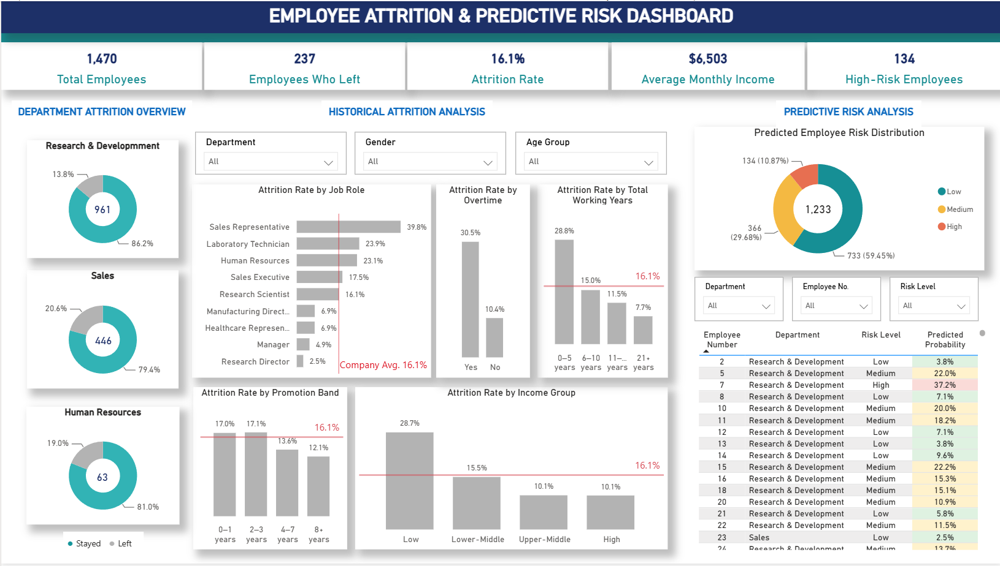
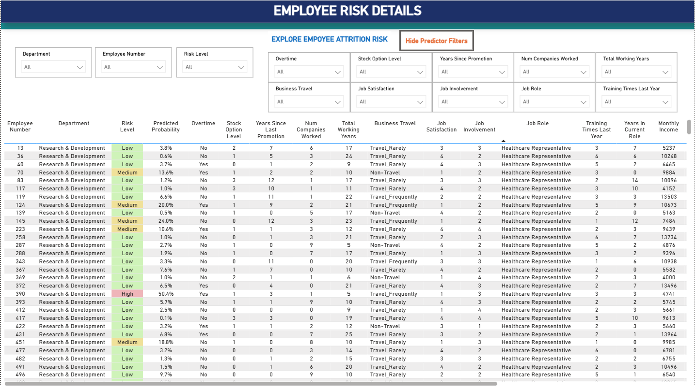

  

# 📊 IBM HR Employee Attrition Analytics

**Python • Machine Learning • Power BI • Streamlit • HR Analytics**

> Understanding employee attrition, estimating future risk and supporting practical HR retention decisions.
> 
### 🌐 Live Interactive Streamlit Application

[Launch the HR Employee Attrition Analytics Dashboard](https://ibm-hr-attrition-analytics-h9hbananbldwcmri8d6uti.streamlit.app/)

Explore historical attrition patterns, employee predictive risk and model insights through the interactive Streamlit application.

[📓 Python Notebook](IBM_HR_Attrition_Capstone.ipynb) · [🖼️ Dashboard Screenshot](HR_Attrition_Dashboard.png)

---

## 1. 🎯 Project Overview

Employee attrition can affect workforce stability, operational continuity and recruitment planning. Understanding employee attrition patterns is important for developing effective retention strategies.

This project uses the IBM HR Employee Attrition dataset to analyse employee attrition patterns, develop and evaluate predictive machine learning models, and propose practical HR retention recommendations.

The main objective is to **support HR in reducing employee attrition**, while enabling more proactive workforce planning through data-driven insights.

## 2. ❓ Business Problem

How can employee data be analysed to identify key factors associated with employee attrition, predict employees' likelihood of leaving, and support targeted retention strategies and proactive workforce planning to reduce attrition and minimise staffing gaps?

## 3. 🎯 Project Objectives

1. Analyse employee attrition patterns across departments, job roles and key employee characteristics to identify groups with higher attrition rates.
2. Develop and compare machine learning models to predict employee attrition.
3. Evaluate the selected predictive model, assess probability calibration and identify important predictors of attrition.
4. Assess predicted employee attrition risk and develop an interactive Power BI dashboard to support workforce-level analysis and employee risk investigation.
5. Recommend practical HR retention strategies and an implementation plan to help reduce attrition and support proactive workforce planning.

## 4. 📋 Dataset Overview

**Dataset:** IBM HR Employee Attrition dataset

The project uses five related CSV files:

- Employees.csv
- Compensation.csv
- Performance.csv
- Experience.csv
- Employment Status.csv

The datasets were merged using `EmployeeNumber` as the common identifier.

### Prepared Datasets for Power BI and Streamlit

Three prepared datasets are available in this GitHub repository:

- **IBM_HR_Attrition_Cleaned.csv:** Cleaned dataset containing all 1,470 employee records, prepared for descriptive analytics in Power BI.
- **HR_Attrition_Historical.csv:** Historical employee dataset used by the Streamlit application for descriptive attrition analysis.
- **HR_Attrition_Predictive_Risk.csv:** Predictive risk dataset containing 1,233 employees who stayed, including estimated attrition probabilities and risk categories, used by Power BI and Streamlit.

These datasets support the interactive Power BI report and Streamlit application.

### Dataset Summary

| Indicator | Result |
|---|---:|
| Total Employees | 1,470 |
| Employees Who Left | 237 |
| Employees Who Stayed | 1,233 |
| Overall Attrition Rate | 16.12% |

**Note:** The IBM HR dataset is synthetic. Findings are intended for educational and analytical demonstration rather than direct application to a real organisation.

## 5. 🛠️ Tools and Technologies

| Tool | Purpose |
|---|---|
| Python | Data cleaning, analysis and predictive modelling |
| Pandas and NumPy | Data preparation and transformation |
| Matplotlib and Seaborn | Data visualisation |
| Scikit-learn | Machine learning, calibration and model evaluation |
| Google Colab | Python development environment |
| GitHub | Project documentation and version control |
| Power BI | Interactive dashboard for historical attrition analysis and exploration of precomputed employee risk |
| Streamlit | Interactive web application for descriptive analytics, employee risk exploration, live attrition prediction and model insights |

## 6. 🧹 Data Preparation

The five datasets were integrated into a single employee-level dataset.

Key preparation activities included:

- Merging datasets using `EmployeeNumber`.
- Checking duplicate records, data types and missing values.
- Preparing numerical and categorical variables for analysis.
- Creating employee grouping variables for descriptive analytics.
- Selecting 22 predictors for machine learning.
- Separating training and testing datasets using a stratified split.
- Applying missing-value imputation, scaling and categorical encoding within machine learning pipelines to reduce data leakage.

The dataset was divided into:

- **Training dataset:** 1,176 employees (80%).
- **Testing dataset:** 294 employees (20%).

A stratified split was used to preserve the proportion of employees who left and stayed.

## 7. 🔍 Descriptive Analytics

The descriptive analysis examined overall employee attrition patterns, departmental differences and factors associated with employee attrition.

The analysis covered:

- **Overall attrition:** Total employees, employees who left and overall attrition rate.
- **Departmental attrition:** Comparison of attrition rates across Sales, Human Resources and Research & Development.
- **Overtime and attrition:** Examination of the relationship between overtime and employee attrition across departments.
- **Employee characteristics:** Analysis of attrition patterns by age, job role, monthly income, total working years, years since last promotion, performance rating, job satisfaction and work-life balance.

### Departmental Attrition

| Department | Total Employees | Employees Who Left | Attrition Rate |
|---|---:|---:|---:|
| Sales | 446 | 92 | 20.63% |
| Human Resources | 63 | 12 | 19.05% |
| Research & Development | 961 | 133 | 13.84% |

### Key Findings

| Indicator | Historical finding |
|---|---|
| Overall attrition | 237 of 1,470 employees (16.1%) |
| Highest department attrition | Sales: 20.6% |
| Overtime: Yes | 30.5% attrition |
| Overtime: No | 10.4% attrition |
| Highest attrition job role | Sales Representative: 39.8% |

- Sales recorded the highest observed attrition rate at 20.63%.
- Employees working overtime experienced higher observed attrition rates across departments.
- Lower-income and less-experienced employee groups generally showed higher attrition.
- Employee satisfaction, job roles and other characteristics were examined to identify potential retention concerns.

These findings represent associations and do not establish the causes of employee attrition.

## 8. 🤖 Predictive Analytics

Two machine learning models were developed using 22 selected predictors:

- Logistic Regression
- Random Forest

Both models were evaluated using five-fold stratified cross-validation on the training dataset.

### Cross-Validation Performance

| Evaluation Metric | Logistic Regression | Random Forest |
|---|---:|---:|
| ROC AUC | 0.831 | 0.808 |
| Recall | 0.753 | 0.463 |
| F1-Score | 0.495 | 0.496 |

**Logistic Regression was selected** because it achieved higher ROC AUC (0.831 vs 0.808) and substantially higher recall (0.753 vs 0.463). Although Random Forest achieved a marginally higher F1-score, Logistic Regression was considered more suitable for this project because identifying employees at potential risk of leaving is a key priority for proactive HR retention planning.

### Held-Out Test Performance

The selected Logistic Regression model was evaluated on 294 previously unseen test employees.

| Evaluation Metric | Logistic Regression |
|---|---:|
| Accuracy | 0.759 |
| Precision | 0.370 |
| Recall | 0.723 |
| F1-Score | 0.489 |
| ROC AUC | 0.795 |

The model correctly identified 34 of the 47 employees who left in the test dataset. However, it also classified 58 employees who stayed as likely departures at the default classification threshold.

This demonstrates the importance of considering both missed departures and false alerts when interpreting model predictions.

### Probability Calibration

Because the original Logistic Regression model used balanced class weights, its predicted probabilities required further assessment.

Sigmoid probability calibration was applied using cross-validation on the training dataset.

| Training Cross-Validation Measure | Result |
|---|---:|
| Original Model Brier Score | 0.160 |
| Calibrated Model Brier Score | 0.098 |
| Calibrated Model ROC AUC | 0.827 |
| Mean Calibrated Predicted Probability | 16.2% |
| Actual Training Attrition Rate | 16.2% |

The calibrated model achieved a lower cross-validated Brier Score (0.098 compared with 0.160), indicating improved probability prediction quality. The mean calibrated predicted probability (16.2%) was also aligned with the actual training attrition rate (16.2%).

Calibration was performed using the training dataset, while the held-out test dataset was kept separate for subsequent evaluation and risk analysis.

### Important Predictive Factors

Permutation importance was used to assess the contribution of individual predictors to the calibrated Logistic Regression model's predictive performance.

The **Top 10 predictors**, ranked using permutation importance on the held-out test dataset, were:

1. Overtime
2. Stock Option Level
3. Years Since Last Promotion
4. Number of Companies Worked
5. Total Working Years
6. Business Travel
7. Job Satisfaction
8. Job Involvement
9. Job Role
10. Training Times Last Year

These predictors are included as interactive filters in the Power BI Employee Risk Details page, allowing users to explore employee characteristics alongside their precomputed predicted attrition probabilities and risk levels.

**Important:** Predictor importance indicates how much model performance changes when a feature is disrupted. It does not establish causation or explain why an individual employee may leave. The predictive model uses all 22 selected predictors, not only the Top 10 listed above.

## 9. 🎯 Employee Attrition Risk Study

The calibrated Logistic Regression model was used to estimate employee attrition probabilities for the held-out test dataset.

Employees were classified into Low, Medium and High Risk categories using thresholds derived from cross-validated training predictions.

For the **held-out test evaluation**, the approximate thresholds reported in the notebook were:

- **Low Risk:** Predicted probability up to 9.87%.
- **Medium Risk:** Above 9.87% and up to 26.74%.
- **High Risk:** Above 26.74%.

### Risk Segmentation Results

| Risk Category | Employees | Employees Who Left | Observed Attrition Rate |
|---|---:|---:|---:|
| Low Risk | 163 | 12 | 7.36% |
| Medium Risk | 70 | 5 | 7.14% |
| High Risk | 61 | 30 | 49.18% |

The High Risk category contained 61 employees, representing approximately 20.7% of the test dataset.

Of the 47 employees who actually left, 30 were classified as High Risk. This means the High Risk group captured **63.8% of observed departures**.

However, Low and Medium Risk groups had similar observed attrition rates. The model differentiated High Risk employees more clearly than it differentiated Low and Medium Risk employees.

Risk categories represent relative predicted risk rather than certainty that an employee will leave.

### Departmental Risk Findings

| Department | High Risk Employees | High Risk Proportion |
|---|---:|---:|
| Sales | 31 | 37.80% |
| Human Resources | 3 | 20.00% |
| Research & Development | 27 | 13.71% |

Sales had the highest proportion of employees classified as High Risk in the test dataset.

The Human Resources test sample was small, so its results should be interpreted cautiously.

### High Risk Employee Profiles

The analysis compared employee characteristics across predicted risk levels within each department.

High Risk employees in Sales and Research & Development generally showed:

- Greater overtime exposure.
- Fewer total working years.
- Lower median monthly income.

For example, in Research & Development, 70.37% of High Risk employees worked overtime, compared with 11.02% of Low Risk employees.

Job satisfaction was also examined, although differences across risk groups were not consistent in every department.

These patterns partly reflect characteristics used by the prediction model and should not be interpreted as independent evidence of causation.

### Applying the Model to Employees Who Stayed

The held-out test dataset above was used to evaluate risk categories against **known attrition outcomes**. Separately, the calibrated model was applied to **1,233 employees who stayed** to demonstrate how HR could review current employees' estimated attrition risk.

| Predicted Risk Level | Employees Who Stayed | Share |
|---|---:|---:|
| Low | 733 | 59.45% |
| Medium | 366 | 29.68% |
| High | 134 | 10.87% |
| **Total** | **1,233** | **100.00%** |

The final employee-risk export used the following cut-offs: **Low ≤ 9.80%**, **Medium > 9.80% to 27.12%**, and **High > 27.12%**. These differ slightly from the held-out test thresholds above and should be interpreted within their respective analyses.

**Important:** The 134 High Risk employees are **not** 134 confirmed future departures. These are model-generated estimates from a synthetic educational dataset.

## 10. 💡 HR Retention Recommendations

Based on the descriptive and predictive findings, five retention strategies are proposed for further investigation and pilot implementation.

| Priority Area | Proposed HR Recommendation |
|---|---|
| Working Experience and Career Development | Strengthen onboarding, mentoring, employee check-ins and development support for less-experienced employees. |
| Workload and Overtime | Review overtime patterns, staffing levels and workload distribution, particularly in teams with greater overtime exposure. |
| Job Role and Compensation | Review attrition patterns by job role, compensation competitiveness, internal pay equity and career progression opportunities. |
| Employee Engagement | Conduct pulse surveys, structured feedback sessions and department-specific improvement initiatives. |
| Sales Retention | Conduct a focused Sales retention review and pilot suitable interventions before wider implementation. |

### Departmental Priority

**Sales is proposed as the initial focus** because it recorded both the highest overall observed attrition rate (20.63%) and the highest proportion of High Risk employees in the test dataset (37.80%).

Research & Development should also be included in targeted investigation, particularly regarding overtime exposure and less-experienced employees.

Interventions should be informed by employee feedback and operational investigation rather than predictive scores alone.

## 11. 🗓️ Proposed Implementation Roadmap

A phased approach is recommended to investigate retention concerns, pilot interventions and evaluate their effectiveness.

| Phase | Timeline | Main Activities |
|---|---|---|
| Phase 1: Investigate | Months 1–2 | Review attrition patterns, overtime, employee feedback and working experience; identify priority groups. |
| Phase 2: Pilot | Months 3–5 | Introduce selected workload, mentoring, engagement and career development initiatives. |
| Phase 3: Evaluate | Months 6–8 | Monitor satisfaction, overtime, participation and retention indicators against baseline performance. |
| Phase 4: Refine and Scale | Months 9–12 | Improve initiatives based on evaluation and consider wider implementation. |

The timelines are proposed for planning purposes and do not represent actual implementation commitments.

### Suggested HR Monitoring Indicators

- Overall and departmental attrition rates.
- Attrition rates by experience group, job role and income group.
- Overtime hours and percentage of employees working overtime.
- Employee satisfaction scores.
- Six-month and twelve-month retention.
- Participation in retention initiatives.
- Changes in retention outcomes following pilot implementation.

Predictive risk scores should support workforce-level analysis and voluntary employee support, not serve as the sole basis for individual employment decisions.

## 12. 📊 Interactive Power BI Dashboard

An interactive Power BI report combines historical employee attrition analysis with predictive employee risk exploration to support HR decision-making.

The report allows HR users to identify historical attrition patterns, examine workforce risk distribution and investigate individual employee risk profiles.

### Dashboard Features

| Section | What HR Can Explore |
|---|---|
| Department Attrition Overview | Employee headcount, historical attrition rates and departmental comparisons |
| Historical Attrition Analysis | Attrition patterns by job role, overtime, working experience, promotion history and income |
| Predictive Risk Analysis | Distribution of Low, Medium and High predicted attrition risk among employees who stayed |
| Employee Risk Details | Employee-level predicted attrition probabilities, risk categories and relevant employee characteristics |
| Interactive Filters | Department, employee number, risk level and the Top 10 predictive factors |

**Full-company snapshot:** 1,470 employees · 237 employees left · 16.1% historical attrition rate · 1,233 employees stayed · 134 employees classified as High Risk.

### Employee Risk Exploration

The Employee Risk Details page includes 10 interactive predictor filters, accessible through the **Show Predictor Filters / Hide Predictor Filters** buttons.

These filters allow HR users to explore employees based on characteristics such as overtime, job satisfaction, working experience, business travel and promotion history.

The employee details table displays each employee's precomputed predicted attrition probability and corresponding risk level.

**Important:** Filtering employees does not recalculate their predicted probabilities. The predictions were generated using the calibrated Logistic Regression model with all 22 selected predictors.

### Power BI Dashboard Screenshots

**1. HR Employee Attrition Dashboard**

**2. Employee Risk Details – Predictive Risk Exploration**

The Employee Risk Details page includes 10 collapsible predictor filters, allowing users to explore employee characteristics alongside their precomputed attrition probabilities and risk levels.

### How HR Can Use the Dashboard

1. **Identify historical patterns:** Examine attrition rates across departments, job roles and employee groups.
2. **Assess workforce risk:** Review the distribution of predicted attrition risk among employees who stayed.
3. **Explore employee profiles:** Use the interactive predictor filters to investigate employees with particular characteristics and review their predicted risk.
4. **Support retention planning:** Combine descriptive findings, predicted risk estimates and HR judgement to identify areas for further investigation.

**Interpretation:** Historical attrition rates describe observed employee departures, while predicted probabilities estimate potential attrition risk. These estimates should support HR review rather than automatic employment decisions.

## 13. 🌐 Interactive Streamlit Application

An interactive Streamlit web application was developed to complement the Power BI report, providing users with access to descriptive analytics, predictive risk exploration, live attrition prediction and model insights.

**[Launch the Interactive HR Attrition Analytics Application](https://ibm-hr-attrition-analytics-h9hbananbldwcmri8d6uti.streamlit.app/)**

### Application Features

| Page | Key Features |
|---|---|
| Integrated Dashboard | Explore historical attrition patterns and predictive risk summaries through interactive visualisations |
| Employee Risk Explorer | Filter employee records and investigate precomputed attrition probabilities and risk categories |
| Live Attrition Prediction | Enter employee characteristics to generate a new predicted attrition probability using the trained model |
| Model Insights | Review model performance, predictor rankings and key considerations when interpreting predictions |

### Power BI vs Streamlit

The two platforms serve complementary purposes:

- **Power BI:** Supports historical attrition analysis, workforce monitoring and exploration of precomputed employee risk through interactive dashboards.
- **Streamlit:** Extends the analysis with a web-based interface for employee risk exploration, model interpretation and live prediction using user-provided inputs.

The predictive model uses 22 selected employee characteristics. Live predictions are generated from the trained model rather than by filtering existing employee records.

**Note:** This application uses a synthetic educational dataset. Predictions are intended for analytical demonstration and should not be used as the sole basis for employment decisions.

## 14. ⚠️ Project Limitations

- The IBM HR dataset is synthetic and may not reflect actual organisational behaviour.
- Predictive results are based on a limited held-out test dataset.
- The Human Resources department has a small sample, limiting the reliability of departmental comparisons.
- Low and Medium Risk groups showed similar observed attrition rates in the test dataset.
- The dataset does not contain resignation dates, recruitment lead times or onboarding durations needed to estimate recruitment start dates.
- Statistical associations and model predictions do not establish causation.
- Predictive models require further validation, calibration assessment and bias review before real-world use.
- Employee risk predictions should not be used as the sole basis for individual employment decisions.

## 15. ✅ Conclusion

This project demonstrates how descriptive and predictive analytics can support HR decision-making.

The descriptive analysis identified departmental attrition patterns, while predictive modelling estimated employee attrition risk using a calibrated Logistic Regression model.

The risk analysis highlighted Sales as a priority for further investigation and identified employee characteristics that may inform targeted retention initiatives.

The findings provide a foundation for HR retention strategies, ongoing performance monitoring and more proactive workforce planning.

The ultimate business objective is **not simply to predict employee departures, but to help HR identify retention concerns early and evaluate actions that may improve employee retention**.

## 16. 📓 Python Notebook

[View the Google Colab Notebook on GitHub](IBM_HR_Attrition_Capstone.ipynb)

The notebook contains the full data preparation, exploratory analysis, predictive modelling, risk study and HR retention recommendations.
